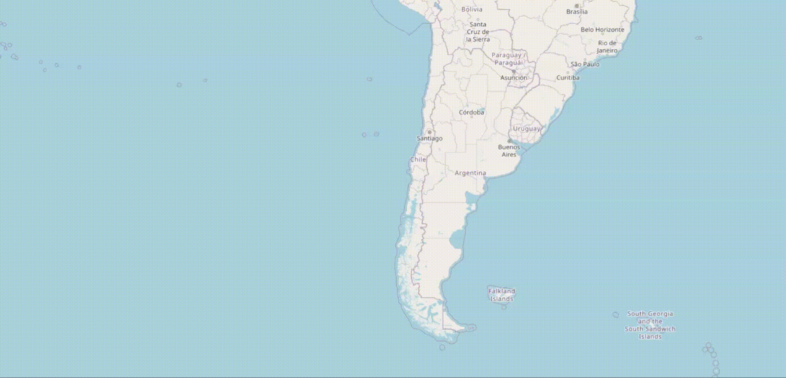

# Bevy GeoTilemap
[](https://crates.io/crates/bevy_geotilemap)
[](https://docs.rs/bevy_geotilemap)
[](#license)
[](https://codecov.io/gh/invap/bevy_geotilemap)

GeoTilemap crate for the [Bevy game-engine](https://bevy.org/) to render slippy tile maps.



## Basic usage

Add the GeoTilemapPlugin to your bevy app, spawn a camera and a GeoTilemap component with your desired tile provider

```rust
let mut app = App::new();
app.add_plugins(DefaultPlugins)
        .add_plugins(GeoTilemapPlugin::default());
```
```rust
let camera = commands
    .spawn((
        Camera2d,
        Camera { ..default() },        
    ))
    .id();

commands.spawn((
    GeoTilemap {
        camera: Some(camera),
        url: "https://tile.openstreetmap.org/{z}/{x}/{y}.png".to_string(),
        ..default()
    },
));
```

If you want a controllable map, similar to your typical web app, you can add the component ControllableMap:

```rust
commands.spawn((
    GeoTilemap {
        camera: Some(camera),
        url: "https://tile.openstreetmap.org/{z}/{x}/{y}.png".to_string(),
        ..default()
    },
    ControllableMap::default()
));
```

This will interact with your camera like you would expect: scroll to zoom, drag to move around.

The feature "markers", provides a simple way of adding markers at a specified longitude and latitude, by spawning a MapMarker component as child of your GeoTilemap entity:

```rust
commands.spawn((
    GeoTilemap {
        camera: Some(camera),
        url: "https://tile.openstreetmap.org/{z}/{x}/{y}.png".to_string(),
        ..default()
    },
    children![
        Sprite::from_image("my_pinpoint.png"),
        MapMarker {
            latitude: 33.821_056,
            longitude: 71.945_98,
        },
    ]
));

```

Checkout the examples to see different features available.

### Features
- Slippy tile dynamic rendering based on camera position.
- 2D camera controls.
- Tile caching using FIFO queue.
- Map markers for simple lat/lon placing of sprites and meshes.
- Customizable map size and position.
- Support for different tile providers as long as they follow [slippy tile zoom representation](https://wiki.openstreetmap.org/wiki/Slippy_map_tilenames).

### Bugs/problems
- If you want to use an external tile server, you have to enable the feature "http"/"https" for bevy. Also if the tile provider uses jpeg, you need to add the feature "jpeg".
```bash 
cargo add bevy --features http https jpeg
```
There is a known [issue](https://github.com/bevyengine/bevy/issues/10157) with bevy's web asset plugin, that tries to get metadata from the external source. To fix it you should disable meta checks from the asset plugin. See example "multiple_maps" for a quick fix.


### Bevy compatibility

| bevy   | bevy_geotilemap |
| ------ | --------------- |
| 0.20.0 | 0.1.0           |
